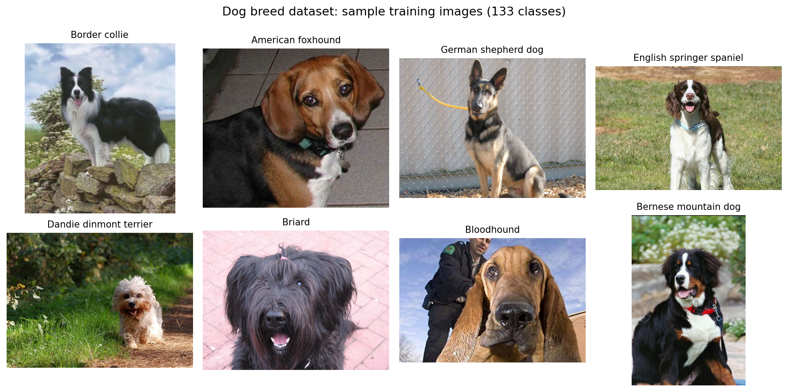
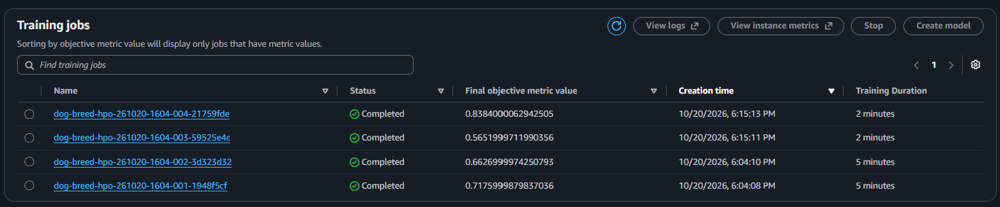
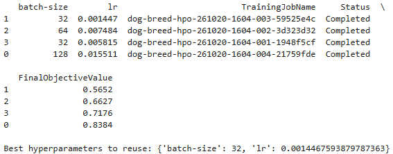
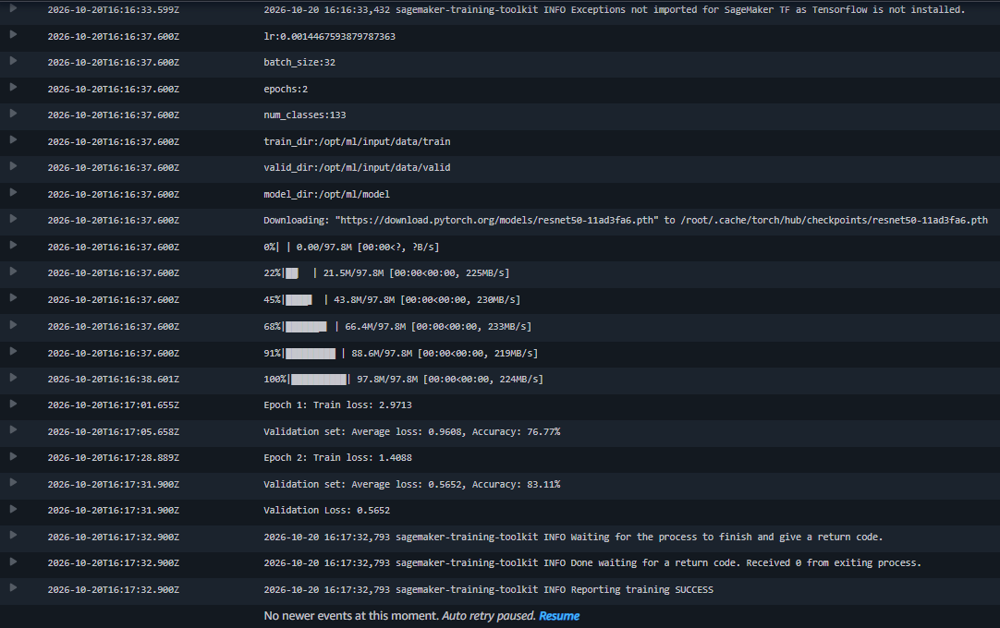
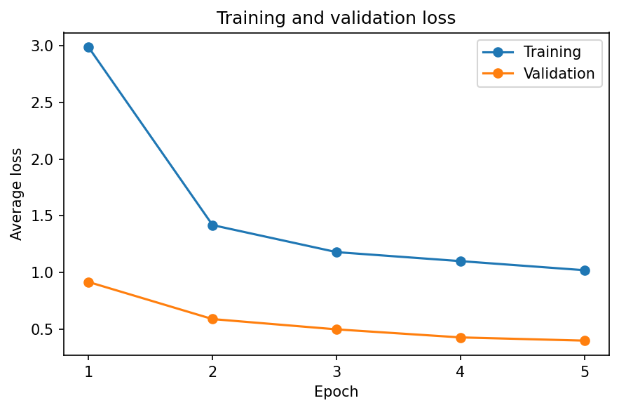
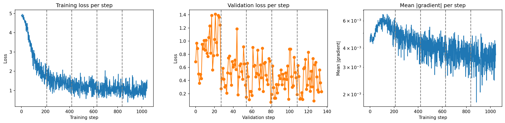
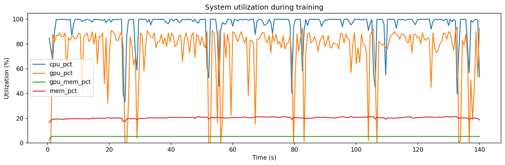
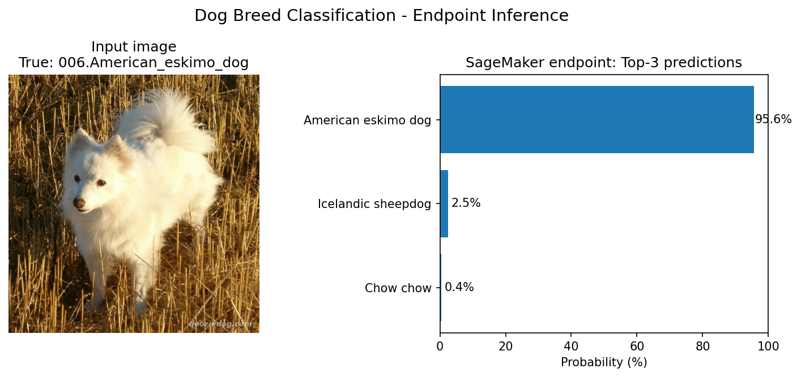

# Image Classification using AWS SageMaker

Fine-tuning a pretrained ResNet50 on the dog breed dataset (133 classes) with AWS SageMaker: hyperparameter tuning, debugging/profiling and deployment.

Built with **SageMaker Python SDK v3** and **PyTorch 2.6 / Python 3.12**. SageMaker Debugger and Profiler are deprecated, so they are replaced by TensorBoard, `torch.profiler` and checks written in the training script.

## Project Set Up and Installation

1. Open SageMaker Studio through the course AWS gateway and clone this repository.
2. Download the dataset to `data/dogImages/` and upload it to S3 (see #access).
3. Run `train_and_deploy.ipynb` in order.

| File | Purpose |
|---|---|
| `train_and_deploy.ipynb` | HPO, training, profiling, deployment |
| `hpo.py` | Lightweight script for HPO trials |
| `train.py` | Final training with debugging/profiling |
| `inference.py` | Endpoint handler |
| `images/` | README screenshots |

## Dataset

133 dog breeds, already split into `train/`, `valid/` and `test/` with one folder per breed (compatible with `ImageFolder`). One corrupted image (`098.Leonberger/Leonberger_06571.jpg`) was found and removed before training.



### Access

Data was uploaded to `s3://<default-bucket>/project/data/{train,valid,test}/` and passed to the jobs as the `train`, `valid` and `test` channels.

images/s3_dataset.png

## Hyperparameter Tuning

**Model:** ResNet50 pretrained on ImageNet, with a frozen backbone and a new head (`Linear(2048, 256) → ReLU → Dropout(0.3) → Linear(256, 133)`), trained with Adam and cross-entropy. Transfer learning gives strong results quickly on about 6,700 training images.

| Hyperparameter | Type | Range |
|---|---|---|
| `lr` | Continuous | 0.001 – 0.1 |
| `batch-size` | Categorical | 32, 64, 128 |

- **Objective:** minimize validation loss (the test set isn't used during tuning).
- **Budget:** 4 trials, 2 in parallel, 2 epochs each, on `ml.g4dn.xlarge`.

**Best hyperparameters:** `batch-size` = 32, `lr` = 0.00145 (validation loss 0.5652).





## Debugging and Profiling

| Original SageMaker feature | Replacement |
|---|---|
| Debugger hook (losses, gradients) | TensorBoard scalars and histograms, `metrics.csv` |
| Profiler system monitor | Background thread sampling CPU/RAM/GPU every 500 ms |
| Framework profiling | `torch.profiler` on the first epoch |
| Debugger rules | Same checks evaluated after training → `rules.json` |

### Results

Final training: 5 epochs on `ml.g4dn.xlarge` with the best hyperparameters. **All rules passed. Test accuracy: 86.36%.**

| Rule | Status | Detail |
|---|---|---|
| LossNotDecreasing | ok | first 5 steps = 4.883, last 5 = 1.079 |
| VanishingGradient | ok | min mean\|grad\| = 2.37e-03 |
| Overfit | ok | val/train loss ratio = 0.40 |
| Overtraining | ok | val loss improved every epoch (0.909 → 0.412) |
| DataLoaderBottleneck | ok | 10% of step time waiting for data |
| LowGPUUtilization | ok | median GPU utilization = 83% |

| Epoch | Train loss | Val loss | Val acc |
|---|---|---|---|
| 1 | 2.986 | 0.909 | 76.0% |
| 3 | 1.179 | 0.504 | 83.1% |
| 5 | 1.020 | 0.412 | 87.2% |

**Insights:**
- **No overfitting:** validation loss is lower than training loss, because training uses augmentation and dropout.
- **Still improving at epoch 5:** more epochs, or unfreezing the last ResNet block, would likely help.
- **Efficient GPU use:** 83% median utilization, and only 10% of step time spent waiting for data.

#### Training convergence


#### Debugging


#### Profiling


The SageMaker Profiler HTML report can't be generated anymore because the service is deprecated. It's replaced by `rules.json`, `torch_profiler_summary.txt` and the TensorBoard logs in `profiler_output/`. <!-- TODO: check the folder name -->

## Model Deployment

- **Artifact:** `model.tar.gz` (`model.pth` + `classes.json`), repacked with `code/inference.py`, because the PyTorch inference container only loads custom code from there.
- **Endpoint:** PyTorch 2.6 CPU inference image on `ml.m5.large`. <!-- TODO: check the instance -->
- **Preprocessing happens in the endpoint:** clients send raw image bytes and receive the top 3 breeds as JSON.

images/endpoint_inservice.png

```python
import json, boto3

with open("path/to/dog.jpg", "rb") as f:
    payload = f.read()

response = boto3.client("sagemaker-runtime").invoke_endpoint(
    EndpointName=endpoint_name, ContentType="image/jpeg", Body=payload,
)
print(json.loads(response["Body"].read()))
```

### Endpoint inference

The endpoint accepts raw JPEG/PNG images. Preprocessing is performed inside `inference.py` using the same transformations used for validation.

For the example below, the true class is `American_eskimo_dog`. The endpoint correctly classified it with **95.6% confidence**.



## Standout Suggestions

- Migration to SageMaker SDK v3 (`ModelTrainer`, `HyperparameterTuner.tune()`)
- Debugger/Profiler replaced with AWS-recommended tools
- Corrupted image detected and removed before training
- `classes.json` saved with the model, so the endpoint returns breed names

## License

Starter material © Udacity, Inc., used under `LICENSE.txt`. The SDK v3 migration, debugging/profiling, inference code and analysis are my own work.